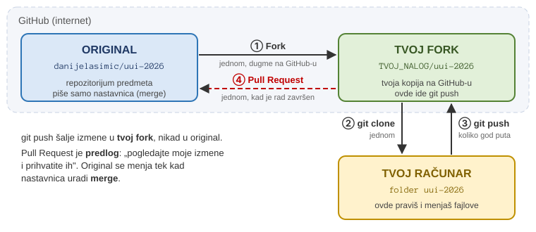

# uui-2026

Repozitorijum za izradu seminarskog rada iz predmeta **Uvod u informatiku**, školska 2026/2027.

Tema ove godine: **naredbe terminala**. Svaki student obrađuje jednu naredbu (ili jednu varijantu složene naredbe) iz spiska tema.

Kroz seminarski učite osnovni Git/GitHub tok rada koji se koristi u praksi:

**fork → grana (branch) → commit → push → pull request → code review → merge**

> Specifikacija sadržaja seminarskog (šta mora da bude u HTML i LaTeX delu) nalazi se na
> [stranici predmeta](https://poincare.matf.bg.ac.rs/~danijela.simic/uui.html#uui-seminarski).
> Ovaj dokument objašnjava **kako** se rad predaje i kako se radi code review.

Svi predati radovi: https://danijelasimic.github.io/uui-2026/

---

## Pročitaj pre početka: postoje DVA repozitorijuma na GitHub-u (i jedan kod tebe)

Najčešća zabuna: student misli da radi u repozitorijumu predmeta, a zapravo radi u **svojoj kopiji**. To je namerno i tako treba.

| | Repozitorijum predmeta (**original**) | Tvoj **fork** | **Lokalni klon** |
|---|---|---|---|
| Gde je | GitHub: `github.com/danijelasimic/uui-2026` | GitHub: `github.com/TVOJ_NALOG/uui-2026` | tvoj računar, folder `uui-2026` |
| Čiji je | nastavnice | tvoj | tvoj |
| Ko u njega piše | **samo nastavnica** (merge PR-ova) | ti (`git push`) | ti (praviš i menjaš fajlove) |
| Koliko puta ga praviš | — | **jednom** (dugme *Fork*) | **jednom** (`git clone`) |



### Zašto fork? Zašto ne radimo svi direktno u repozitorijumu predmeta?

Zamisli da nastavnica ima dokument na koji 70 ljudi treba da doda po jedan deo. Kad bi svi imali pravo da menjaju original, bilo ko bi mogao slučajno (ili namerno) da obriše ili pokvari tuđi deo. Zato:

1. Svako napravi **svoju kopiju** (fork). U svojoj kopiji radiš šta hoćeš i ne možeš ništa pokvariti drugima.
2. Kad završiš, pošalješ **predlog izmene** originalu — to je **Pull Request**. PR ne menja original; on kaže: „ovo su moje izmene, molim vas pogledajte ih i prihvatite".
3. Kolege mogu da pregledaju predlog (**code review**), a nastavnica odlučuje da li ga prihvata (**merge**). Tek tada se tvoj rad pojavljuje u originalu i na sajtu.

Tako se radi i u stvarnom svetu: na projektima kao što su Linux, Python ili VS Code doprinose hiljade ljudi koje vlasnici ne poznaju. Niko od njih nema pravo da menja originalni repozitorijum — svi rade u svom forku i šalju Pull Request.

### Šta odakle ide — kratka pravila

- `git push` šalje izmene **u tvoj fork**, nikad u original. `origin` = tvoj fork.
- U originalu se tvoj rad pojavljuje **tek posle merge-a**. Dok čekaš, tvoj rad je u tvom forku i u tvom Pull Request-u — to je u redu.
- **Ne praviš novi fork** ni novi PR za ispravke. Samo `commit` + `push`, i PR se sam ažurira.

---

## Sadržaj

0. [Rokovi i pregled koraka](#0-rokovi-i-pregled-koraka)
1. [GitHub nalog](#1-github-nalog)
2. [Prijava teme i fork](#2-prijava-teme-i-fork)
3. [Personal Access Token (PAT)](#3-personal-access-token-pat)
4. [Kloniranje repozitorijuma](#4-kloniranje-repozitorijuma)
5. [Pravljenje svoje grane](#5-pravljenje-svoje-grane)
6. [Tvoj folder i fajlovi](#6-tvoj-folder-i-fajlovi)
7. [Upisivanje u glavni `index.html`](#7-upisivanje-u-glavni-indexhtml)
8. [Add, commit, push](#8-add-commit-push)
9. [Pull Request (predaja rada)](#9-pull-request-predaja-rada)
10. [Izmene nakon komentara](#10-izmene-nakon-komentara)
11. [Code review](#11-code-review)
12. [Merge](#12-merge)
13. [Šta je zabranjeno](#13-šta-je-zabranjeno)
14. [Česti problemi](#14-česti-problemi)

---

## 0. Rokovi i pregled koraka

| Šta | Rok |
|---|---|
| Prijava teme u tabeli (sa GitHub korisničkim imenom) | **[DATUM]** |
| Otvoren Pull Request (predaja) | **[DATUM]** |
| Code review jednog rada + link u svom `README.md` | **[DATUM]** |

Ukratko, šta radiš:

1. Napraviš GitHub nalog i prijaviš temu u tabeli.
2. Napraviš **fork** repozitorijuma predmeta (svoju kopiju na GitHub-u).
3. Kloniraš **svoj fork** i napraviš **svoju granu**.
4. U folderu `studenti/ime_prezime_brindeksa/` napraviš svoj rad.
5. U glavnom `index.html` zameniš **jedan red** u slotu svoje teme.
6. Pošalješ (push) svoju granu u svoj fork i otvoriš **Pull Request** ka repozitorijumu predmeta.
7. Uradiš **code review** jednog tuđeg rada i link ka njemu upišeš u svoj `README.md`.

---

## 1. GitHub nalog

1. Otvorite https://github.com i napravite nalog koristeći **fakultetski mejl** (npr. `mi26042@alas.matf.bg.ac.rs`).
   Ako već imate nalog sa drugim mejlom, možete ga koristiti — samo dodajte fakultetski mejl u **Settings → Emails**.
2. Zapamtite svoje **GitHub korisničko ime** (username) — upisujete ga u tabelu za prijavu teme.

> Preporuka: u podešavanjima profila (**Settings → Public profile → Name**) upišite svoje pravo ime i prezime.
> Tako se na Pull Request-ovima i recenzijama vidi ko ste.

---

## 2. Prijava teme i fork

### Prijava teme

U tabeli za prijavu tema (link je na stranici predmeta) izaberite **slobodnu** temu i u njenom redu upišite:
ime, prezime, broj indeksa, **GitHub korisničko ime** i fakultetski mejl.
GitHub korisničko ime je potrebno da bi se vaš nalog, Pull Request i recenzija mogli povezati sa vama.

### Fork (radi se jednom)

1. Prijavite se na GitHub i otvorite repozitorijum predmeta: https://github.com/danijelasimic/uui-2026
2. Gore desno kliknite **Fork**.
3. Na sledećoj strani ostavite sve kako jeste (*Owner* = vaš nalog, ime `uui-2026`) i kliknite **Create fork**.
4. Otvoriće se **vaš fork**. Proverite adresu u pregledaču i natpis ispod imena repozitorijuma:

   ```
   github.com/TVOJ_NALOG/uui-2026
   forked from danijelasimic/uui-2026
   ```

   Ako vidite `forked from danijelasimic/uui-2026`, na pravom ste mestu. Od sada radite **samo sa ovim repozitorijumom**.

> Ne pravite fork više puta. Ako ste već napravili fork, dugme *Fork* vas samo vodi na postojeći.

---

## 3. Personal Access Token (PAT)

GitHub **ne dozvoljava lozinku** za `git push`. Umesto lozinke koristi se token.

> 💡 Na Windows-u (Git for Windows) i na macOS-u, pri prvom `push`-u obično se otvori prozor pregledača u kome se samo prijavite na GitHub — tada token **nije potreban**. Ako se to desi, preskočite ovaj korak.

1. Na GitHub-u: slika profila → **Settings** → **Developer settings** → **Personal access tokens** → **Tokens (classic)** → **Generate new token (classic)**.
2. Podešavanja:
   - *Note*: npr. `uui-seminarski`
   - *Expiration*: npr. 90 dana (da traje do kraja semestra)
   - *Scopes*: ✔ `repo`
3. Kliknite **Generate token** i **kopirajte token** — prikazuje se samo jednom.

Da ne biste token unosili pri svakom `push`-u (na sopstvenom računaru):

```bash
git config --global credential.helper store
```

> Ovo token čuva kao običan tekst u `~/.git-credentials`. Na računarima u učionici **nemojte** ovo da radite.

---

## 4. Kloniranje repozitorijuma

Klonirate **svoj fork**, ne repozitorijum predmeta. U adresi je **vaše** korisničko ime:

```bash
git clone https://github.com/TVOJ_NALOG/uui-2026.git
cd uui-2026
```

(Adresu možete i kopirati: na stranici svog forka kliknite zeleno dugme **Code** → **HTTPS** → ikonica za kopiranje.)

Proverite da `origin` pokazuje na vaš fork:

```bash
git remote -v
# origin  https://github.com/TVOJ_NALOG/uui-2026.git (fetch)
# origin  https://github.com/TVOJ_NALOG/uui-2026.git (push)
```

Ako umesto svog naloga vidite `danijelasimic`, klonirali ste original. Ispravka:

```bash
git remote set-url origin https://github.com/TVOJ_NALOG/uui-2026.git
```

Ako Git traži identitet (dovoljno je jednom po računaru):

```bash
git config --global user.name "Ime Prezime"
git config --global user.email "mi26042@alas.matf.bg.ac.rs"
```

---

## 5. Pravljenje svoje grane

**Nikada ne radite na grani `main`.** Odmah posle kloniranja napravite svoju granu.

Ime grane = ime vašeg foldera: `ime_prezime_brindeksa`, sve malim slovima, **bez naših slova** (š→s, đ→dj, č→c, ć→c, ž→z), reči odvojene donjom crtom.

```bash
git checkout -b petar_petrovic_mi26042
```

Proverite na kojoj ste grani:

```bash
git branch        # zvezdica (*) označava trenutnu granu
git status        # prvi red: "On branch petar_petrovic_mi26042"
```

> Ako ste već klonirali repozitorijum ranije i samo nastavljate rad: `git checkout petar_petrovic_mi26042` (bez `-b`).

---

## 6. Tvoj folder i fajlovi

Napravite folder `studenti/ime_prezime_brindeksa/` (isto ime kao grana):

```
studenti/petar_petrovic_mi26042/
│
├── README.md       → podaci o tebi, temi i code review-u (šablon ispod)
├── index.html      → početna strana (proizvoljan sadržaj, npr. o tebi)
├── tema.html       → naredba: šta radi, sintaksa, opcije
├── primeri.html    → primeri upotrebe sa izlazom
├── style.css       → zajednički stilovi za sve strane
├── main.tex        → LaTeX izvor
├── rad.pdf         → PDF preveden iz main.tex
└── slike/          → slike koje koristi projekat
```

Detaljni zahtevi za sadržaj su na [stranici predmeta](https://poincare.matf.bg.ac.rs/~danijela.simic/uui.html#uui-seminarski).

### Važno

- Sve putanje u HTML-u su **relativne** (`slike/terminal.png`, `style.css`, `tema.html`) — **ne** `C:\Users\...` ni `/home/...`.
  Na Linux serveru (GitHub Pages) **velika i mala slova se razlikuju**: `Slika.PNG` ≠ `slika.png`.
- HTML i CSS pišete **ručno**. Nisu dozvoljeni generatori sajtova, šabloni i CSS okviri (Bootstrap, Tailwind, Wix, Hugo...). JavaScript je dozvoljen.
- `rad.pdf` mora da nastane prevođenjem **vašeg** `main.tex` (pdflatex/xelatex/lualatex ili Overleaf). PDF napravljen u Word-u ili nekim drugim alatom se ne priznaje.
- GitHub Copilot i drugi AI alati su **dozvoljeni**, ali morate razumeti sve što ste predali i sve primere morate sami isprobati u terminalu. U `README.md` kratko napišite za šta ste koristili AI.
- Bez velikih fajlova: svaka slika ispod 500 KB, ceo folder ispod 5 MB. Ne dodavati `.aux`, `.log`, `.zip`, `.exe` i slične fajlove.

### Šablon za `README.md` u tvom folderu

Kopirajte ovo u `studenti/ime_prezime_brindeksa/README.md` i popunite:

```markdown
# Ime Prezime — <naredba>

- **Broj indeksa:** mi26042
- **GitHub korisničko ime:** petar-petrovic
- **Tema:** T27 — grep: osnovni regularni izrazi (BRE)
- **Sajt:** https://danijelasimic.github.io/uui-2026/studenti/petar_petrovic_mi26042/index.html

## Sadržaj foldera

Kratko (1–3 rečenice): šta se nalazi na kojoj strani.

## Korišćenje AI alata

Npr: "Copilot sam koristio za predloge CSS-a za navigaciju i za proveru LaTeX tabele.
Sve primere naredbi sam pokrenuo sam u terminalu." (Ako niste koristili, napišite to.)

## Code review

- **Recenzirao/la sam:** PR #NN — https://github.com/danijelasimic/uui-2026/pull/NN
- **Autor rada:** Ime Prezime, tema TNN — <naredba>
- **Moja odluka:** Approve / Request changes / Comment
- **Link ka mojoj recenziji:** <link>
```

> Link ka recenziji: na stranici Pull Request-a, u kartici **Conversation**, pored vaše recenzije kliknite na `...` → **Copy link**.
> Ovaj odeljak dopunjujete **posle** urađene recenzije: izmenite README, pa `add` / `commit` / `push` — vaš PR se sam ažurira.
> **Bez ovog linka code review se ne boduje.**

---

## 7. Upisivanje u glavni `index.html`

Glavni `index.html` (u korenu repozitorijuma) već sadrži **slot za svaku temu**. Menjate **tačno jedan red** — onaj u slotu svoje teme:

```html
                <!-- T27 -->
                <li class="tema" id="T27">
                    <span class="id">T27</span> <span class="naziv">grep — osnovni regularni izrazi (BRE)</span> ...
                    <span class="nije-predato">još nije predato</span>      ← SAMO OVAJ RED
                </li>
```

zamenite sa:

```html
                    <a href="studenti/petar_petrovic_mi26042/index.html">Petar Petrović</a>
```

- Ne dodajete nove redove, ne brišete prazne redove, ne menjate naziv teme ni tuđe slotove.
- Zašto ovako? Svaka tema ima svoj, odvojen red. Zato Git može da spoji izmene 70 studenata **bez konflikata**. Ako dodate ili obrišete redove oko slota, napravićete konflikt sa kolegom.

---

## 8. Add, commit, push

Pre svakog commita proverite šta ste izmenili:

```bash
git status
```

Treba da vidite **samo** svoj folder `studenti/ime_prezime_brindeksa/` i (jednom) `index.html`. Ako vidite tuđe fajlove ili smeće (`.aux`, `.log`, `.DS_Store`...), nemojte koristiti `git add .` — dodajte fajlove pojedinačno.

```bash
git add studenti/petar_petrovic_mi26042 index.html
git commit -m "Dodata tema.html za grep (T27)"
```

Prvi put kada šaljete granu na GitHub (u **svoj fork** — to je `origin`):

```bash
git push -u origin petar_petrovic_mi26042
```

Kada Git pita:

- **Username**: vaše GitHub korisničko ime
- **Password**: nalepite **token** (ne lozinku!). Dok lepite, ništa se ne prikazuje — to je normalno.

Svaki sledeći put dovoljno je:

```bash
git add ...
git commit -m "Opis izmene"
git push
```

> Commit-ujte i push-ujte često (npr. posle svake završene strane). Commit poruke treba da opisuju šta ste uradili — "aaa" i "izmena" nisu dobre poruke.

---

## 9. Pull Request (predaja rada)

Pull Request (PR) otvarate **tek kad je rad završen** — otvoren PR znači "predajem rad na pregled". Pre toga možete push-ovati koliko god puta hoćete.

1. Otvorite **svoj fork** (`github.com/TVOJ_NALOG/uui-2026`).
2. Ako ste nedavno push-ovali, pojaviće se žuta traka sa dugmetom **Compare & pull request**. Ako je nema: kartica **Pull requests** → **New pull request**.
3. Proverite red na vrhu — PR ide **iz vašeg forka u original**:

   ```
   base repository: danijelasimic/uui-2026   base: main   ←   head repository: TVOJ_NALOG/uui-2026   compare: ime_prezime_brindeksa
   ```

   Levo (*base*) je **original** i grana `main`; desno (*head*) je **vaš fork** i **vaša grana**.
4. Naslov PR-a: `T27 — grep: osnovni regularni izrazi — Petar Petrović (mi26042)`
5. Opis PR-a se automatski popuni kontrolnom listom. **Prođite kroz nju** i štiklirajte (`[x]`) ono što ste uradili.
6. Ostavite štiklirano **Allow edits by maintainers** (tako nastavnica može da reši eventualni konflikt umesto vas).
7. Kliknite **Create pull request**. PR se sada vidi u originalu: https://github.com/danijelasimic/uui-2026/pulls

U kartici **Files changed** proverite da PR sadrži **samo** vaš folder i jedan izmenjen red u `index.html`.

> Vi **ne merge-ujete** i **ne zatvarate** PR — ni svoj, ni tuđi. Samo ga otvarate.
> Jedan student = jedan PR. Ne otvarajte novi PR za ispravke — samo push-ujte na istu granu.

---

## 10. Izmene nakon komentara

Kada recenzent ili nastavnica ostave komentar ili zatraže izmene (**Request changes**):

1. Izmenite fajlove lokalno (na svojoj grani!).
2. Ponovo:
   ```bash
   git add ...
   git commit -m "Ispravke po recenziji: alt tekst slika, link ka primeri.html"
   git push
   ```
3. PR se **automatski** ažurira. Na komentar možete odgovoriti (npr. "Ispravljeno u commitu ...") i kliknuti **Resolve conversation**.

---

## 11. Code review

Svaki student radi **code review jednog** Pull Request-a kolege.

Code review nije formalnost. Recenzent je prva provera kvaliteta: ako kaže da je rad u redu, on za to **garantuje**. Zato se poeni za code review dobijaju **samo** ako ste rad stvarno pogledali i dali sopstveni, obrazložen sud.

### 11.1 Ključno pravilo (pročitajte dvaput)

> ❗ **Ako odobrite (Approve) rad kome očigledno nedostaje neki obavezan deo, dobijate 0 poena za code review.**
> Ti poeni se **ne mogu nadoknaditi**: ne može se naknadno promeniti odluka niti uraditi nova recenzija na drugom radu.

Obavezni delovi su oni iz kontrolne liste u 11.4. "Očigledno nedostaje" znači da se vidi pregledom fajlova i otvaranjem sajta i PDF-a, npr:

- nema `main.tex`, ili `rad.pdf` očigledno nije nastao iz njega;
- PDF nije na ćirilici, nema sadržaj, nema tabelu, formulu, sliku, teoremu/definiciju/lemu;
- nema tri HTML strane ili linkovi između njih ne rade;
- nema tabele, liste, slike sa `alt` tekstom...;
- stilovi su u HTML-u (*inline*) umesto u `style.css`, ili je sajt napravljen generatorom/šablonom;
- nema `README.md` ili nije izmenjen slot u glavnom `index.html`.

Isto važi i ako odaberete **Comment**, a uopšte ne primetite da nedostaje obavezan deo — takva recenzija nije stvarno urađena.

### 11.2 Koju opciju da izaberete

| Opcija | Kada | Šta mora da sadrži |
|---|---|---|
| **Request changes** | Nedostaje **bilo koji obavezan deo** ili nešto ne radi (link, slika, PDF). | Šta tačno nedostaje i gde. |
| **Approve** | **Svi** obavezni delovi su tu i rade. | Popunjenu kontrolnu listu + obrazloženje (šta je dobro, šta bi moglo bolje). |
| **Comment** | Imate pitanja ili sugestije, ali ne dajete konačnu ocenu (npr. niste sigurni da li nešto ispunjava zahtev). | Konkretna pitanja/sugestije; kontrolna lista i dalje mora biti popunjena. |

Pravilo palca: **sumnjate li da nešto obavezno fali → Request changes.** Approve tek kada ste proverili sve stavke.

### 11.3 Kako da izaberete PR

1. Otvorite https://github.com/danijelasimic/uui-2026/pulls
2. Izaberite PR koji **nije vaš** i koji **još nema recenziju** (u listi PR-ova i u desnoj koloni PR-a, odeljak *Reviewers*, vidi se ko je već recenzirao).
   Ako svi otvoreni PR-ovi već imaju recenziju, izaberite onaj sa najmanje recenzija.
3. Jedan PR može imati **najviše 2 studentske recenzije** koje se boduju. Treća i svaka sledeća recenzija istog PR-a se ne boduje — proverite pre nego što počnete.
4. Boduje se samo **vaša prva** recenzija. Recenzije posle roka se ne boduju.

### 11.4 Kako da uradite review (korak po korak)

1. U PR-u otvorite karticu **Files changed** i pregledajte fajlove.
2. **Otvorite sajt i PDF**, ne samo kod. U kartici *Files changed*, kod fajla kliknite `...` → **View file**; za PDF i slike GitHub prikazuje sadržaj.
   Da biste sajt otvorili u pregledaču, preuzmite rad kolege **iz njegovog forka**:
   - na vrhu PR-a piše `wants to merge ... from KOLEGA:ime_prezime_kolege` — kliknite na `KOLEGA:ime_prezime_kolege`;
   - otvoriće se fork kolege na njegovoj grani → zeleno dugme **Code** → **Download ZIP**;
   - raspakujte ZIP i otvorite `studenti/ime_prezime_kolege/index.html` u pregledaču.

   Ovo je samo za gledanje — u tuđi fork ne možete ništa da upišete, i ne treba.
3. Ostavite **bar jedan komentar na konkretnoj liniji koda**: pređite mišem preko broja linije i kliknite plavi **`+`**, napišite komentar i kliknite **Start a review** (ne *Add single comment*).
4. Kliknite **Review changes** (zeleno dugme gore desno), nalepite popunjen šablon ispod, izaberite **Comment / Approve / Request changes** i kliknite **Submit review**.
5. Kopirajte link ka recenziji i upišite ga u svoj `README.md` (vidi [šablon](#šablon-za-readmemd-u-tvom-folderu)).

### Šablon recenzije (kopirajte u polje *Review changes*)

```markdown
## Code review — T__ <naredba>

### Obavezni delovi
- [ ] Folder `studenti/ime_prezime_brindeksa/` sa ispravnim imenom
- [ ] `README.md` sa podacima i temom
- [ ] Izmenjen samo svoj slot u glavnom `index.html` i link radi
- [ ] Tri HTML strane (`index.html`, `tema.html`, `primeri.html`), povezane navigacijom koja radi na svakoj strani
- [ ] Tema je obrađena: šta naredba radi, sintaksa, opcije (tabela), primeri sa izlazom
- [ ] Svi obavezni HTML elementi (naslovi, paragrafi, liste, tabela, slika sa smislenim `alt`, unutrašnji i spoljašnji link, `<pre>`/`<code>`)
- [ ] Spoljni `style.css`, bez inline stilova; pozadina, stilovi naslova/linkova, `:hover`, navigacija na vrhu
- [ ] HTML/CSS pisan ručno (nije generator ni šablon)
- [ ] Slike su lokalne i prikazuju se (relativne putanje)
- [ ] `main.tex` postoji i `rad.pdf` odgovara njemu
- [ ] PDF: ćirilica, sadržaj, naslov/autor/datum, poglavlja i potpoglavlja, formula, tabela, liste, slika, definicija + teorema + lema, različiti formati teksta, zaključak

### Šta je dobro urađeno
(bar 2 konkretne stvari)

### Šta bi trebalo popraviti ili poboljšati
(bar 1 konkretna stvar, sa navedenim fajlom/stranom)

### Odluka i obrazloženje
(1–2 rečenice: zašto Approve / Request changes / Comment)
```

Ako neka stavka nije ispunjena, ne štiklirajte je i u obrazloženju napišite šta nedostaje. Onda je jedina ispravna odluka **Request changes**.

### 11.5 Kako se boduje code review (4 poena)

| Situacija | Poeni |
|---|---|
| Popunjena lista, bar jedan inline komentar, konkretna zapažanja, odluka u skladu sa stanjem rada, link u svom `README.md` | 4 |
| Recenzija je ispravna, ali površna (npr. bez inline komentara ili bez konkretnih predloga) | 1–3 |
| **Approve** rada kome očigledno nedostaje obavezan deo | **0 — ne može se popraviti** |
| Comment koji ne primećuje da obavezan deo nedostaje | 0 |
| "LGTM", "OK", "Super", "Lepo urađeno", prazna recenzija, samo štiklirana lista bez obrazloženja | 0 |
| Nema linka ka recenziji u svom `README.md` | 0 |
| Recenzija sopstvenog rada, treća ili kasnija recenzija istog PR-a, recenzija posle roka | 0 |

> Recenzent se ocenjuje prema stanju rada **u trenutku recenzije**. Ako autor kasnije ispravi rad, to ne menja ocenu recenzenta.
> Autor rada ne gubi poene zbog loše recenzije koju je dobio, i obrnuto — dobra recenzija ne podiže ocenu rada.

### 11.6 Nakon review-a

- Autor vidi komentare, pravi izmene i push-uje na istu granu. Ako želite, možete ponovo pogledati rad i ostaviti novi komentar (nije obavezno i ne boduje se dodatno).
- Nije potrebno slati mejl ili poruku.

---

## 12. Merge

- Pull Request **merge-uje isključivo nastavnica** (tehnički je onemogućeno svima ostalima).
- Posle merge-a vaš rad se pojavljuje na https://danijelasimic.github.io/uui-2026/ (može da potraje nekoliko minuta).

---

## 13. Šta je zabranjeno

U original ne možete ništa da upišete, ali vaš Pull Request može da sadrži izmene koje ne smeju da uđu. Svako od ovoga se kažnjava oduzimanjem poena (do svih poena za Git deo):

- izmena tuđeg foldera ili tuđeg slota u `index.html`;
- menjanje bilo čega van svog foldera i svog jednog reda u `index.html` (proverite *Files changed*!);
- više otvorenih Pull Request-ova (jedan student = jedan PR);
- zatvaranje svog PR-a i otvaranje novog umesto push-ovanja ispravki;
- veliki i nepotrebni fajlovi (video, arhive, izvršni fajlovi, LaTeX pomoćni fajlovi).

---

## 14. Česti problemi

**`remote: Permission to danijelasimic/uui-2026.git denied` / greška 403**
Pokušavate da push-ujete u **original** umesto u svoj fork — klonirali ste pogrešan repozitorijum. Ispravka (commitovi ostaju):
```bash
git remote set-url origin https://github.com/TVOJ_NALOG/uui-2026.git
git push -u origin petar_petrovic_mi26042
```
Ako se i posle toga javlja 403, prijavljeni ste pogrešnim nalogom: obrišite sačuvane podatke (Windows: *Credential Manager* → *Windows Credentials* → obrišite `git:https://github.com`).

**`Authentication failed`**
Kao lozinku ste uneli lozinku naloga umesto tokena, ili je token istekao / nema `repo` dozvolu.

**Radio sam na grani `main` (zaboravio sam `git checkout -b`)**
Napravite svoju granu od trenutnog stanja (commitovi idu sa vama) i nju push-ujte, pa PR otvorite iz te grane:
```bash
git checkout -b petar_petrovic_mi26042
git push -u origin petar_petrovic_mi26042
```

**Ne vidim svoj PR u repozitorijumu predmeta / PR je otvoren unutar mog forka**
Pri otvaranju PR-a *base repository* nije bio `danijelasimic/uui-2026`. Zatvorite taj PR (on je u vašem forku, to je dozvoljeno) i otvorite novi, proverivši red *base ← head* (korak 9.3).

**Na GitHub-u piše „This branch is X commits behind danijelasimic:main"**
To je normalno — drugi radovi su u međuvremenu spojeni u original. Ne morate ništa da radite; vaš PR menja samo vaš folder i vaš red, pa se spaja bez problema.

**`error: src refspec petar_petrovic_mi26042 does not match any`**
Grana se drugačije zove ili još nemate nijedan commit. Proverite sa `git branch` i `git log`.

**Pogrešno ime foldera**
```bash
git mv studenti/staro_ime studenti/petar_petrovic_mi26042
git commit -m "Ispravljeno ime foldera"
git push
```

**Slike se vide kod mene, a na GitHub Pages ne**
Apsolutna putanja (`C:\...`) ili razlika u velikim/malim slovima u imenu fajla.

**Slučajno sam commit-ovao `.aux`, `.log` ili sličan fajl**
```bash
git rm --cached studenti/petar_petrovic_mi26042/main.aux
git commit -m "Uklonjen pomoćni LaTeX fajl"
git push
```

**Konflikt u `index.html`**
Ne pokušavajte da ga rešavate nasumično. Napišite komentar u svom PR-u — nastavnica će ga rešiti pri merge-u.

---

Ovaj proces je vrlo sličan onome što se koristi u pravim softverskim timovima i na projektima otvorenog koda: svako radi u svojoj kopiji (fork) i na svojoj grani, izmene se predlažu kroz Pull Request, kolege ih pregledaju, a u glavnu granu ih spaja odgovorna osoba.
